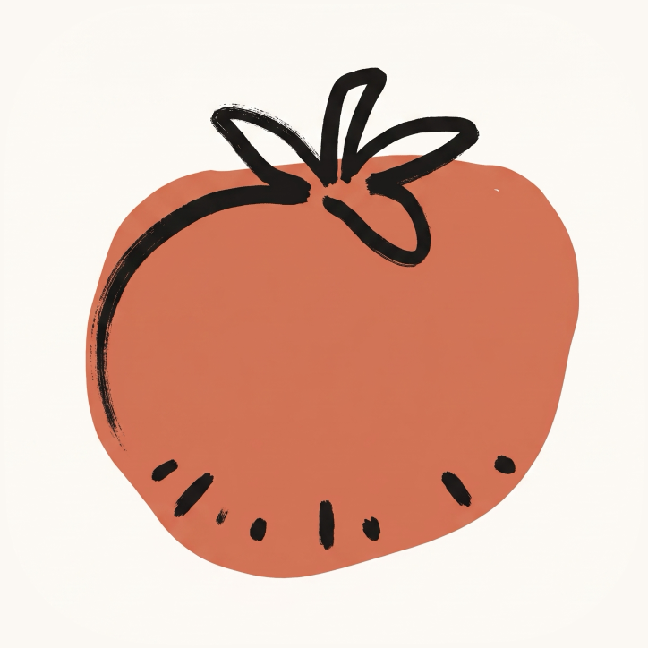

# Tamatem

Tamatem (طماطم, Arabic for tomatoes) is a Pomodoro timer for Claude Code. Start a focus block with `/tamatem start`, keep working, and a subtle band above the prompt shows the time left and your rounds. When a block ends you get a small toast, a break idea, and a tomato for the day.

```
╭──────────────────────────────────────────────────────────────────────────────╮
│ 🧠 fix login bug   ████████████████████▌░░░░░░░░░░░░░░░░░░░░  12:30  ● ◐ ○ ○ │
╰──────────────────────────────────────────────────────────────────────────────╯
```

No colours and no blinking: it sits at the edge of your attention while the work has the focus.

## Install

At the prompt of a Claude Code terminal session:

```
/plugin install tamatem --marketplace hassanhafezzz/tamatem
```

Answer `y` to add the marketplace, then pick a scope (user scope loads it in every session). It's active straight away, with no restart. Its command is `/tamatem`.

From a shell:

```
claude plugin install tamatem --marketplace hassanhafezzz/tamatem
```

In the desktop app, where `/plugin` does not run: click **+** next to the prompt box, then **Plugins**, **Add marketplace** with `hassanhafezzz/tamatem`, then **Add plugin**.

## What it looks like

A focus block, halfway through. The round dots show it's the second of four:

```
╭──────────────────────────────────────────────────────────────────────────────╮
│ 🧠 fix login bug   ████████████████████▌░░░░░░░░░░░░░░░░░░░░  12:30  ● ◐ ○ ○ │
╰──────────────────────────────────────────────────────────────────────────────╯
```

Paused, with the clock frozen:

```
╭──────────────────────────────────────────────────────────────────────────────╮
│ ⏸ fix login bug   ██████████████████████████▉░░░░░░░░░░░░░░░  09:00  ● ◐ ○ ○ │
╰──────────────────────────────────────────────────────────────────────────────╯
```

The block is done. The band keeps the next step first, then the day's tomatoes and a break idea:

```
╭──────────────────────────────────────────────────────────────────────────────╮
│ 🔔 fix login bug done   ████████████████████████████████████  ● ● ○ ○        │
│ today 🍅🍅🍅  ·  /tamatem break for 5 min  ·  Stand up and stretch.          │
╰──────────────────────────────────────────────────────────────────────────────╯
```

On a break, with the idea underneath:

```
╭──────────────────────────────────────────────────────────────────────────────╮
│ ☕ short break  ██████████████▋░░░░░░░░░░░░░░░░░░░░░░░░░░░░░  03:20  ● ● ○ ○ │
│ Stand up and stretch.                                                        │
╰──────────────────────────────────────────────────────────────────────────────╯
```

The break is over, and the next round is waiting:

```
╭──────────────────────────────────────────────────────────────────────────────╮
│ 🔔 break over   ████████████████████████████████████████████  ● ● ○ ○        │
│ today 🍅🍅🍅  ·  /tamatem start for round 3                                  │
╰──────────────────────────────────────────────────────────────────────────────╯
```

After the fourth round, the break is a long one:

```
╭──────────────────────────────────────────────────────────────────────────────╮
│ 🛌 long break   ██████████████▋░░░░░░░░░░░░░░░░░░░░░░░░░░░░░  10:00  ● ● ● ● │
│ It's time for a short walk.                                                  │
╰──────────────────────────────────────────────────────────────────────────────╯
```

When a block ends, a short toast says what finished and what to do next:

```
🔔 fix login bug done · /tamatem break for 5 min
```

### In the chat

```
/tamatem start 25 fix login bug
🧠 focus started: 25 min · fix login bug

/tamatem pause
⏸ Paused the focus with 09:00 left. /tamatem resume to carry on.

/tamatem strat
Unknown: /tamatem strat. Did you mean /tamatem start?

/tamatem stats
📊 Focus
Today:        3 🍅 · 1h 15m focused
This week:   11 🍅 · 4h 35m focused
This month:  38 🍅 · 15h 50m focused
This year:  212 🍅 · 88h 20m focused
All time:   212 🍅 · 88h 20m focused

🎯 Today's tasks
  fix login bug · 2 🍅 · 50 min
  write the docs · 1 🍅 · 25 min
```

## Use it

```
/tamatem start                    a 25-minute focus block
/tamatem start fix login bug      the same, named for what you're doing
/tamatem start 50 write the docs  50 minutes, named
/tamatem break                    a break: short, or long after every 4th round
/tamatem pause                    pause the block; again (or /tamatem resume) to carry on
/tamatem stop                     stop the block, or clear the band once it's done
/tamatem                          where you are, and today's stats
```

A first word that's a number is the minutes; the rest names the task.

### The band

| You see | It means |
| --- | --- |
| `🧠 focus` or `🧠 <task>` | a focus block is running |
| `☕ short break`, `🛌 long break` | a break is running, with an idea for it underneath |
| `⏸` | the block is paused |
| `🔔 … done`, `🔔 break over` | a block just ended, with the next command to run |
| `● ◐ ○ ○` | rounds: ● a focus block done, ◐ the one running, ○ one to come. When all are ●, the long break is due |

The band shows in the terminal and in the desktop app. Claude Code doesn't offer that space in VS Code or on mobile, so there you'll get the toast and `/tamatem`.

### Stats

```
/tamatem stats                  today, this week, month, year and all time, plus today's tasks
/tamatem stats reset            shows what would be deleted
/tamatem stats reset confirm    deletes every count
```

`/tamatem history` works the same as `/tamatem stats`.

### Settings

```
/tamatem set                    show the current lengths
/tamatem set focus 30           focus 1-180 min, short 1-60, long 1-120, rounds 1-12
/tamatem set reset              back to 25 / 5 / 15, 4 rounds
/tamatem toast on|off           a pop-up when a block ends (on by default)
/tamatem sound on|off           a soft chime when a block ends (off by default, macOS only)
/tamatem help                   every command
```

## How it works

Tamatem is a Claude Code hooks module with three hooks:

- **`session.start`** registers the `/tamatem` command and picks up a block that was running: it keeps counting down, or, if it ended while Claude Code was closed, it's counted and reported.
- **`command.run`**, for `/tamatem` only, answers the command. Tamatem sees no other command.
- **`ui.render`**, on the band above the prompt, draws its band while there's a block to show and passes the band on, so whatever else draws there stacks underneath. With nothing to show, it draws nothing.

Beyond those it uses Claude Code's clock for the countdown, its store for your data, its toasts, and, when you turn sound on, its player for the bundled chime. Tamatem reads no files, runs no programs, makes no network calls, and reads no credentials.

## Your data

Everything stays on your machine, in Tamatem's own store under your Claude Code configuration folder: the running timer, your settings, and a count of focus blocks per day (with task names, if you give them). Days more than a year old are merged into an all-time total and their task names dropped, so the store stays small. Tamatem makes no network calls.

A block keeps running across restarts. One that ended while Claude Code was closed is counted and reported as "while you were away".

## Develop

```
claude plugin validate .
claude plugin test .
claude --plugin-dir .
```


## License

[MIT](LICENSE)
